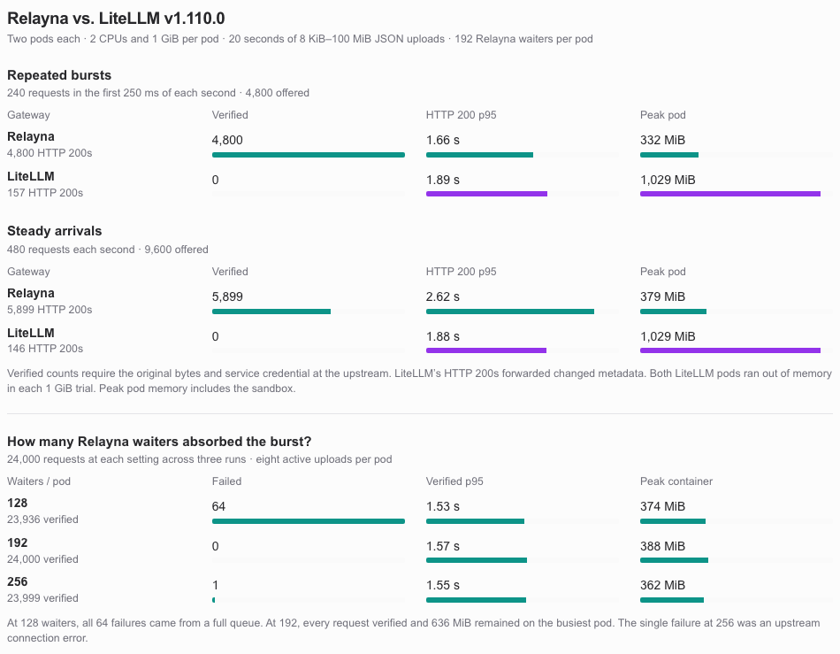

# Upload benchmark evidence for Relayna Gateway PR #155

On 19 November 2026, three burst trials at 192 waiters per pod verified **24,000 of 24,000** requests. Verified p95 was **1.57 s** and the busiest gateway container peaked at **388 MiB** of its 1 GiB limit. The tested release build came from [PR #155](https://github.com/sarattha/relayna-gateway/pull/155) at [ec32558](https://github.com/sarattha/relayna-gateway/commit/ec32558c25528596b6cd7b6cd9e2d0c9cfe712cb).



| Review question | Evidence |
|---|---|
| How did enabling waiting affect verified uploads, 503s, and forwarding latency? | [Disabled and 16-waiter controls, plus direct-to-upstream latency](pr155-performance/report.md) |
| How much memory and time did additional waiters cost? | [Waiter sizing report](pr155-wait-headroom/report.md), [per-trial CSV](pr155-wait-headroom/trial-results.csv), [three-seed burst totals](pr155-wait-headroom/burst-qualification.json) |
| How did sustained overload behave over a minute? | [Ten-second arrival cohorts](pr155-wait-headroom/steady-windows.csv) |
| How did Relayna compare with LiteLLM v1.110.0? | [Matched two-pod comparison](pr155-wait-headroom/head-to-head/report.md), [results by request size](pr155-wait-headroom/head-to-head/by-size.csv), [semantic controls](pr155-wait-headroom/head-to-head/semantic-controls.json) |
| Which binary, images, limits, and machine were measured? | [Build, platform, and harness provenance](pr155-wait-headroom/provenance.json) |

Both gateways used authenticated HTTP/1.1 passthrough and a mock upstream on a local arm64 kind cluster. The client sent nine synthetic JSON body sizes from 8 KiB to 100 MiB. Verification required a 200 response, the original byte count and SHA-256 at the upstream, and the expected upstream credential. The LiteLLM report additionally checks parsed JSON equivalence. Burst qualification used two 20-second trials and one 60-second trial. The separate head-to-head used one 20-second trial per condition and an identical 8 KiB warmup.

Raw client observations are in the per-trial gzip-compressed JSON files. The matching directories contain pod inventories and memory samples. The [interactive graphs](pr155-wait-headroom/gateway-performance-graphs.html) open locally after download. Run the following command from the root of the extracted archive to verify every evidence file.

```sh
shasum -a 256 -c SHA256SUMS
```
